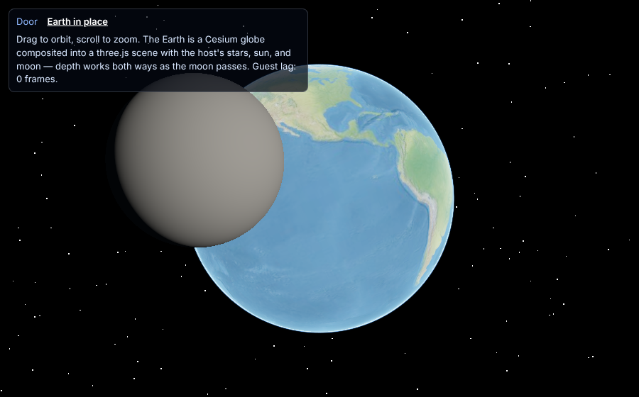
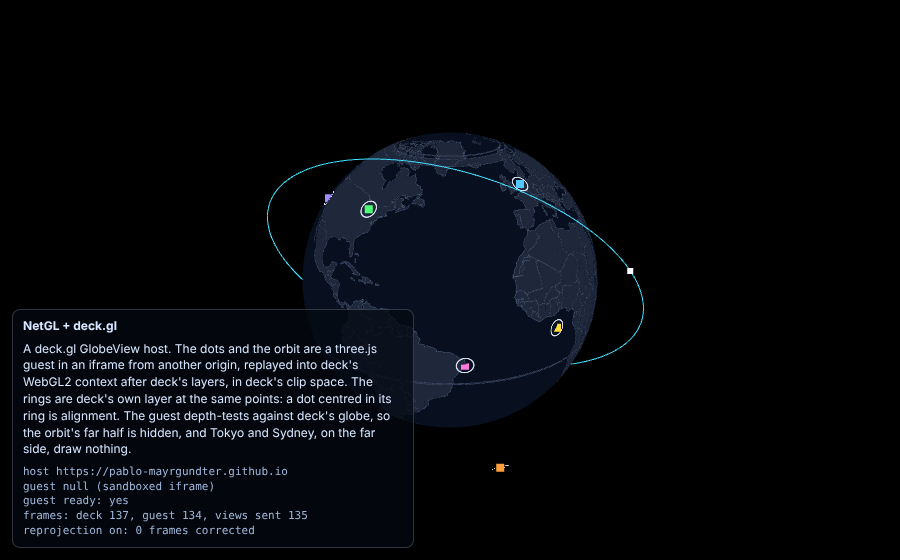

# Portal

**Link independent 3D web renderers at the GL layer.**

- **Portals:** doors from one 3D web world into another.
- **In-place layers:** one engine's content drawn where another engine's
  object was, such as Cesium's Earth in place of a three.js Earth.

Both run on **NetGL**: a guest renderer's WebGL calls are recorded, sent
over a transport, and replayed into the host's own context, where the host
decides which pixels they may touch.

> **Status: early prototype.** [celestiary](https://celestiary.github.io/)
> uses NetGL in production for Cesium's Earth, Moon and Mars. The APIs and
> wire format will change before 1.0, and only trusted guests are safe.
> We're looking for testers, RFCs and adopters: see
> [Get involved](#get-involved).



*Cesium's globe replayed into a three.js scene, depth-tested against the
host's moon ([live](https://pablo-mayrgundter.github.io/portal/netgl-cesium/?mode=earth)).*

## Why

Web 3D engines (three.js, CesiumJS, Babylon.js, Unity WebGL, splat
renderers) each own their scene graph, camera, frame loop and GL state.
Putting two in one view usually means rewriting one into the other, or a
flat video texture. Scene graphs don't compose, but every engine emits GL
draws. NetGL runs the guest's draws in the host's context: no bitmap
round-trip, no depth packing, occlusion both ways.

```
 guest (Cesium, three.js, ...)                 host (three.js app)
 ─────────────────────────────                 ───────────────────
 renderer ─► recorder Proxy ─┬─ shadow GL ctx   scene render
             (WebGL2 calls)  │  (sync answers)  stencil: where the guest may draw
                             └── transport ───► replay into the host's GL context
                                 (same page,    screen policy: stencil clip,
                                  postMessage,  clear filtering, blending
                                  worker, ...)  post-passes, UI
```

## See it

Live demos (GitHub Pages; WebGL2 required):

| Demo | What it shows |
|---|---|
| [Local portal](https://pablo-mayrgundter.github.io/portal/three/) | two three.js worlds joined by a door you can walk through |
| [iframe portal](https://pablo-mayrgundter.github.io/portal/iframe/) | the destination world in an iframe, shipped as colour and depth bitmaps (frame-RPC) |
| [Worker portal](https://pablo-mayrgundter.github.io/portal/worker/) | the same, rendered in a Web Worker with no DOM |
| [NetGL portal](https://pablo-mayrgundter.github.io/portal/netgl/) | a three.js guest's GL command stream replayed into the host's canvas |
| [NetGL + celestiary](https://pablo-mayrgundter.github.io/portal/netgl-celestiary/) | a real app, the [celestiary](https://github.com/celestiary/web) solar system, through a door |
| [NetGL + Cesium, door](https://pablo-mayrgundter.github.io/portal/netgl-cesium/) | an unmodified Cesium globe through a door, with real parallax |
| [NetGL + Cesium, in place](https://pablo-mayrgundter.github.io/portal/netgl-cesium/?mode=earth) | Cesium's globe in place of a three.js Earth: the moon occludes it and is occluded by it |
| [NetGL + deck.gl](https://pablo-mayrgundter.github.io/portal/netgl-deck/) | a three.js guest from another origin drawn over a deck.gl globe, in deck's clip space |
| [Docs](https://pablo-mayrgundter.github.io/portal/) | the site's root: the summary, the RFC responses, one page per RFC, and how NetGL got here |

Every release's demos and docs are kept under `/portal/v/<version>/`, and
a version pulldown moves between them.



*A three.js guest in a sandboxed cross-origin iframe, replayed into deck.gl's
context in its clip space; the orbit's far half is hidden by deck's globe
([live](https://pablo-mayrgundter.github.io/portal/netgl-deck/)).*

## What works, and what doesn't yet

WebGL2 guests (three.js; Cesium unmodified) draw into three.js and
deck.gl hosts, on the same page or from an iframe on another origin: as a
*door*, *in place* of a host object, or as an *overlay* in the host's clip
space. The [CHANGELOG](./CHANGELOG.md) says which version added what.
Untrusted guests, resource lifecycle and WebGPU are among DESIGN.md's
[open problems](./packages/portal-netgl/DESIGN.md#open-problems-the-next-pr);
what the RFCs ask for next is in the responses'
[synthesis](./docs/rfcs/responses/README.md).

## Packages

| Package | What | Status |
|---|---|---|
| [`@pablo-mayrgundter/portal-netgl`](./packages/portal-netgl) | NetGL, its links and transports, the Cesium shim, the deck.gl adapter | [on npm](https://www.npmjs.com/package/@pablo-mayrgundter/portal-netgl), 0.6.x; pin an exact version |
| `portal-layers` | host/guest shim for in-place layers | [0.1 design](./docs/portal-layers.md) |
| [`portal-core`](./packages/portal-core), [`-three`](./packages/portal-three), [`-iframe`](./packages/portal-iframe), [`-worker`](./packages/portal-worker), [`-headless-three`](./packages/portal-headless-three), [`-controls`](./packages/portal-controls) | [frame-RPC portals](./docs/frame-rpc-portals.md), demo controls | workspace only |

## Quick start: a Cesium globe in a three.js scene

```sh
npm install @pablo-mayrgundter/portal-netgl
```

```js
import { makeNetGLImmediateLink, makeNetGLCesiumGuest } from '@pablo-mayrgundter/portal-netgl'

const link = makeNetGLImmediateLink({
  gl: renderer.getContext(),
  replay: {
    screenFramebuffer: () => myRenderTargetFramebuffer, // or omit to draw to the canvas
    screen: { stencil: { ref: 1 }, clear: 'depth-only', blend: 'premultiplied-over' },
  },
})
const guest = makeNetGLCesiumGuest({ transport: link.transport })
const widget = new Cesium.CesiumWidget(el, {
  contextOptions: guest.contextOptions,
  useDefaultRenderLoop: false,
  orderIndependentTranslucency: false, // its composite breaks coverage alpha
})
guest.attach(widget.scene)

// Each frame: draw your scene, then a stencil shell where the globe belongs, then:
link.frame(() => widget.render()) // Cesium's calls replay into your context now
renderer.resetState()
```

The [package README](./packages/portal-netgl/README.md) covers the other
links, guests and hosts. For in-place layers, read the
[lessons from celestiary](./packages/portal-netgl/DESIGN.md#lessons-from-celestiarys-cesium-layers)
and the [app's gotchas](./docs/portal-layers.md#gotchas-that-stay-in-the-app).

## Run the demos locally

Requires Node 22 and npm.

```sh
git clone --recurse-submodules https://github.com/pablo-mayrgundter/portal.git
cd portal
npm install
npm run dev                    # local portal (host-three)
npm run dev:iframe             # iframe portal
npm run dev:worker             # Web Worker portal
npm run dev:netgl              # NetGL portal (three.js guest)
npm run setup:celestiary && npm run dev:netgl-celestiary   # NetGL + celestiary
npm run dev:netgl-cesium       # NetGL + Cesium (?mode=door | ?mode=earth)
npm run dev:netgl-deck         # NetGL + deck.gl: host on :5190, cross-origin guest on :5191
npm test                       # vitest
npm run check                  # type-check all workspaces
npm run build                  # production build of all workspaces
```

## Get involved

Each of these has an issue template:

- **Test it** on your browser, OS and GPU, or with a renderer we haven't
  tried (Babylon.js, PlayCanvas, MapLibre, Unity WebGL). Report GL calls
  that fail to replay, with a screenshot and your GPU details.
- **Comment on an RFC, or write one.** The open questions are in the
  [RFCs](./docs/rfcs/README.md) and the maintainers'
  [responses](https://pablo-mayrgundter.github.io/portal/rfcs/).
- **Adopt it.** If your app should embed another engine (a globe, a map,
  a BIM viewer, a splat scene), open an adoption issue. Real integrations
  drive the roadmap.

Development workflow: [CONTRIBUTING.md](./CONTRIBUTING.md).

## Roadmap

The next portal-netgl versions and their tracks of work are in the
responses' [Versions](./docs/rfcs/responses/README.md#versions) table.

## Docs

- [CHANGELOG.md](./CHANGELOG.md), and the
  [Evolution page](https://pablo-mayrgundter.github.io/portal/rfcs/evolution.html)
  ([source](./docs/rfcs/responses/evolution.md)): every release, a
  snapshot of each, and the axes they moved.
- [RFC responses](https://pablo-mayrgundter.github.io/portal/rfcs/):
  the [synthesis](./docs/rfcs/responses/README.md) and a 1-pager per RFC
  ([0001](./docs/rfcs/responses/0001-globe-orbit-layers.md),
  [0002](./docs/rfcs/responses/0002-nested-in-place-guests.md),
  [0003](./docs/rfcs/responses/0003-late-frames.md)).
- NetGL's [API](./packages/portal-netgl/README.md) and
  [DESIGN.md](./packages/portal-netgl/DESIGN.md);
  [`portal-layers`](./docs/portal-layers.md); the [RFCs](./docs/rfcs/README.md).
- History: [NetGL's first design](./docs/netgl-renderer.md),
  [frame-RPC portals](./docs/frame-rpc-portals.md),
  [the preview proxies](./docs/deploying-proxies.md).

## Design rules

1. Engines stay sovereign.
2. Scene graphs are private by default.
3. Pose, time, selection and intent are public.
4. A portal is a coordinate transform plus a live view.
5. Traversal is state handoff, not necessarily a page reload.
6. The host owns the portal geometry. Endpoints are render-from-this-pose services.
7. AI agents should write adapters, not rewrite whole worlds.

## License

[MIT](./LICENSE).
