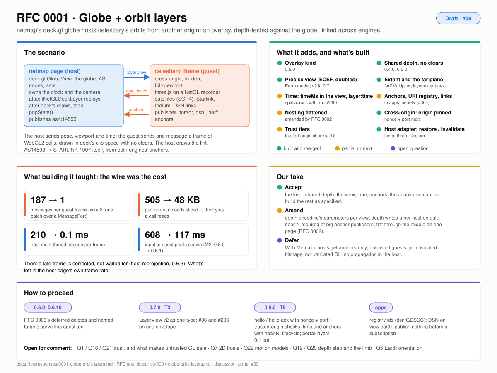

# Response to RFC 0001: globe + orbit layers

| | |
|---|---|
| **RFC** | [`docs/rfcs/0001-globe-orbit-layers.md`](../0001-globe-orbit-layers.md), merged as Draft in portal #35; discussion and findings in [#39](https://github.com/pablo-mayrgundter/portal/issues/39) |
| **Integration** | netmap's deck.gl `GlobeView` hosting celestiary's orbits (satellites, Starlink, Iridium, the DSN) from a cross-origin iframe |
| **Built** | portal-netgl 0.5.0 (#36: the luma.gl host adapter, `layer:view`, origin-pinned transports), 0.6.0–0.6.8 (wire 2, host reprojection, parts); celestiary/web #296, #304; netmap #7, #8 |
| **Tracks** | T5 (control plane and trust), T3 (the view), T6 (packaging); T1 answered its Q29 |
| **Picture** | [rfc-0001.svg](./img/rfc-0001.svg) |

## What it asks

A globe host draws the Earth; a guest from another origin draws things
in orbit around it, in the host's view, hidden by the globe where they
should be, and links join a satellite in one engine to a network node in
the other. Neither a door nor a stencilled shape fits, so the RFC asks
for:

1. an **overlay** kind: no shape, no stencil, the host's exact projection, depth-tested against the host (§4–5);
2. the far plane **sized to the guest's extent**, and content past it clamped as sky (§5.3);
3. a **precise view**: ECEF metres, rigid view, doubles, an Earth model and surface mapping, projections that aren't a 4×4 (§6);
4. **time** owned by the root, with scale offsets, an epoch and an elapsed clock (§7);
5. **anchors**: named positions with a URI registry, subscriptions and links across engines (§8);
6. **nesting** flattened into one context with a tree of frame maps (§9);
7. **cross-origin** iframes with a handshake, capabilities and trust tiers (§10);
8. **host adapter** semantics, restore or invalidate (§11).

## What's built, and what it taught

Most of §4–6 and §11 shipped and held up. The control plane is split
across two implementations that don't yet share an envelope (#36 sends
`{view: {…}}`, #296 reads the fields flat; §6.7). The findings that
changed the design, all now in the DESIGN.md:

- **The wire was the cost, not the GPU.** One message per call put the host's main thread 90–99% busy; one batch per frame over a MessagePort, with uploads sliced to the bytes a call reads, took a frame from 187 messages and 505 KB to 1 and 48 KB, and the host's decode from 210 ms to 0.1 ms (Q29; 0.6.0).
- **A late frame is corrected, not waited for.** Host reprojection rewrites the guest's vertex shaders once and multiplies `gl_Position` by `VP_now · VP_frame⁻¹`; the guest's content lands where the current camera puts it (0.6.3–0.6.7).
- **The frame-end carries the frame's metadata.** `viewId` (0.6.3) answered Q18; `part` (0.6.8) followed. RFC 0003 adds two fields more.
- **Origin is the whole trust boundary today.** Both transports pin origins; a nonce and a port are specified but not built (§10.2).
- **Remaining latency is the host's own frame rate**, not the transport (the M2 captures in #39).

## Our take

| Section | Proposal | Take |
|---|---|---|
| §4 | the overlay kind | **Accept, built.** With 0002's amendment: an overlay may be inserted at a phase inside the host's pass. |
| §5.1 | shared depth, no clears, writes as a grant | **Accept, with change:** the encoding's kind in `hello-ack`, its parameters per view (0002 §5.3); `write` is a per-host default (Q3, settled). |
| §5.3 | extent, far plane, `clamp-to-far` | **Accept.** `layer:extent` on change is unbuilt; add `box` (0002 §5.6). |
| §6 | the view: frames, doubles, Earth model, surface mapping | **Accept; this is T3's `LayerView` v2.** Keep `earth` per view. `frame` becomes any registered id. |
| §6.4 | a projection descriptor for Web Mercator | **Defer.** A 2D host gets anchors only in v1 (Q7). The `shader` kind (a host prelude) is the likely real answer. |
| §7 | `portal.time/1`: `timeMs` in the view, `layer:time` as state | **Accept.** Add `time: 'elapsed'` in hello for guests that animate on wall time (0002 §5.4). |
| §8 | `portal.anchors/1`, the URI registry, links | **Accept, with change:** near-N subscriptions (celestiary #304) are part of the extension, required of a publisher with a large population; the binary table waits for a subscriber that needs whole constellations. Start empty: no anchors before a subscription. |
| §9 | flattened nesting, `layer:children` | **Accept as amended by 0002:** flat through the middle's link on one page; the root creates cross-origin children. |
| §10.1–10.4 | the iframe, the nonce and port, one message per frame, the async scheduler | **Accept.** The port is built (wire 2); the nonce isn't. Opaque-origin guests are supported through the nonce and the port, and a real origin is recommended (Q17). |
| §10.5 | trust tiers | **Accept the tiers; build `trusted-origin`'s cheap checks; don't build `untrusted-gl`.** Untrusted code goes to `isolated` frame-RPC bitmaps (Q16). Add 0002's `same-page` tier. A scissor from an overlay's extent goes in the screen policy anyway (Q1). |
| §10.6–10.7 | capabilities, hello, lifecycle states | **Accept; this is T5.** Make "the host queues control posts until hello" (Q25) and `layer:invalidate` (Q26) normative. |
| §11 | restore vs invalidate; in-layer-order insertion for deck | **Accept, built.** A deck layer that runs the guest (in deck's order) when a host needs its own draws after the guest (Q13). |

## Proposed answers to the open questions

Settled: Q3 (per host), Q11 (flat on one page, root-created cross-origin
children), Q13 (phases for synchronous bindings; one insertion point
async), Q14 (Cesium invalidates; upstreaming the hook is tracked in
cesium-portal), Q18 (fields on the frame-end), Q25, Q26, Q28 (render on
view messages, the guest's libraries included), Q29 (measured and fixed
in 0.6.x).

Proposed here:

- **Q1, Q16, Q21.** Overlays for `bundled`, `same-page` and `trusted-origin`; a nonce per iframe plus origin pinning is enough for those; untrusted code is `isolated`. A capability token comes with the untrusted path, if it is ever built.
- **Q2.** Don't specify `shared-texture` until a host without a per-frustum hook needs it.
- **Q4, Q5.** `timeMs` plus an optional two-part `jd`; the host is the binding source of TAI − UTC and UT1 − UTC. ECEF of date and UT1 are enough; no Earth rotation angle on the wire until two guests visibly disagree.
- **Q6.** Surface-tied positions must use the host's mapping; orbital positions should, and a guest that doesn't says so (`warp: false`).
- **Q7.** Anchors only for 2D hosts in v1.
- **Q8.** Page-local `portal:/path#id` in v1. 0002's `layers:<id>` permalink token covers "switched on"; a cross-page form waits for a permalink that needs it.
- **Q9.** A CURIE-style prefix registry in this repo; `naif:` canonical, `dsn-sc:` an alias.
- **Q10.** Relaying needs both sides' grants.
- **Q12.** One clock at every level; no per-edge time.
- **Q15.** JSON anchors with near-N in v1; the binary table later.
- **Q17.** Supported through the nonce and the port (GitHub Pages previews need it); a real origin recommended.
- **Q19.** Lifting ground geometry is the guest's business; the view already carries what it needs to size the lift (`clipRange` and `bits`).
- **Q20.** Accept the limb mismatch in v1; an optional occluder sphere in the view if it shows.
- **Q22.** No propagation in the host: near-N plus `p + v·Δt` extrapolation covers the links, and SGP4 stays with the publisher.
- **Q23.** The version-claim register is the [tracks table](./README.md#tracks). **Q24.** Yes: entries per framework, each framework an optional peer. **Q27.** A gotcha: a guest page never shares a chunk graph with the host app beside it.

## How to proceed

1. **Now (T1, 0.6.9–0.6.10):** RFC 0003's deferred deletes and named targets also serve this guest; nothing of 0001's changes.
2. **0.7.0 (T3):** `LayerView` v2 as one type in `layer-view.ts`; `globeLayerView` fills it; celestiary's layer page reads `msg.view` so #296 and #36 interoperate.
3. **0.8.0 (T5):** `hello` / `hello-ack` with the nonce and the port, replacing `netgl:ready` and celestiary's `originTransport`; `trusted-origin`'s checks on the replay; `portal.time/1` and `portal.anchors/1` with near-N; lifecycle states; `portal-layers` 0.1 cut from portal-netgl, with the luma adapter moving there.
4. **In netmap and celestiary, in step:** rename the anchor ids to the registry (`dsn:GDSCC`, `dsn-sc:VGR1`); place the DSN complexes by `view.earth`; publish nothing before a subscription.

## What we're asking

Whether decisions 6, 9 and 10 of the [synthesis](./README.md#decisions-were-proposing)
are right: untrusted guests as bitmaps rather than validated GL; no
propagation in the host; anchors only over a 2D map. And from anyone
with a globe or map engine: can it fill R1's view and expose an
insertion point?
