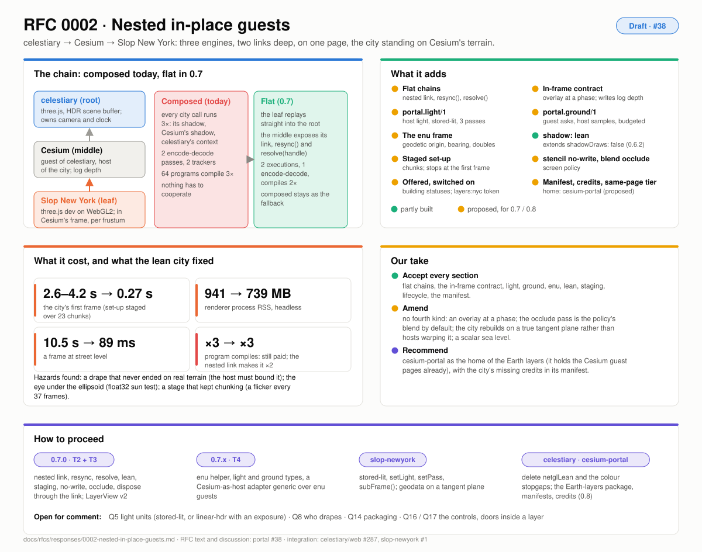

# Response to RFC 0002: nested in-place guests

| | |
|---|---|
| **RFC** | [#38](https://github.com/pablo-mayrgundter/portal/issues/38) (filed as an issue; first opened as portal #37) |
| **Integration** | celestiary (three.js) hosting Cesium on the same page, and Cesium hosting Slop New York (three.js on the WebGPURenderer's WebGL2 backend) inside its own frame, on its terrain |
| **Built** | celestiary/web #287 (the layer, lean shadows, a staged set-up, the colour stopgap), slop-newyork #1 (the guest, `guest-cesium.mjs`, `ground.js`), celestiary/cesium `external-render-pass` (`ExternalRenderer`, `Context.resetState`); portal #34 (`clear: 'none'`, sub-frames). None of the library pieces yet. |
| **Tracks** | T2 (nesting and cost), T3 (the view), T4 (light, ground, frames); T5 for the manifest and the `same-page` tier |
| **Picture** | [rfc-0002.svg](./img/rfc-0002.svg) |

## What it asks

Three engines, two three.js builds and two links deep, on one page. It
works, composed: the city's every call runs on three contexts, its 64
programs compile three times, and most of what made it work is wiring in
celestiary that belongs in portal or in the guest. The RFC asks for:

1. **flat chains** on one page: the leaf replays into the root, and the middle exposes its link, a `resync()` and a handle lookup (§4);
2. the **in-frame contract**: an overlay drawn inside the host's pass, per frustum, writing the host's log depth from per-view parameters, with near and far supplied and a box for bounds (§5);
3. **light and colour**: the guest lights with the host's light in the host's units, emission in a pass of its own, an occlude pass (§6);
4. **the ground**: the guest names sample points, the host answers heights, sea level and a budget, the guest drapes (§7);
5. an **`enu` frame** at a geodetic origin, composed in doubles (§8);
6. into portal-netgl: `shadow: 'lean'`, a staged set-up, the nested link, `stencil: 'no-write'` (§9);
7. a layer **offered by range and switched on**, building statuses, freeing, a permalink token, a `same-page` trust tier (§10);
8. traversal left for later, a camera floor now (§11); a manifest and a home for Earth layers (§12).

## What's built, and what it taught

The chain runs three levels deep and, with the switch off, frames are bit
for bit main's. The costs measured headless (CESIUM.md):

| | composed, as it came | lean (now) | still paid |
|---|---|---|---|
| the city's first frame | 2.6–4.2 s | 0.27 s, over 23 chunks | |
| renderer process RSS | 941 MB | 739 MB | |
| city draws per frame, per context | 182 / 182 / 182 | 0 / 0 / 183 | |
| a frame at street level | 10.5 s | 89 ms | |
| program compiles | ×3 | ×3 | one too many; the nested link fixes it |

Three findings reach beyond this chain: **the drape that never ended on
real terrain** (the host must bound it), **the eye under the host's
reference surface** (a ground layer brings the camera where a host's
float32 tests had never been), and **a staged set-up must stop chunking
at the first frame** (the one-frame flicker on a real GPU). The RFC also
computed that **the city's frame is equirectangular, not a tangent
plane**: 2.4 m off at the Battery, 11 m at Inwood.

## Our take

| Section | Proposal | Take |
|---|---|---|
| §4 | flatten through the middle's link; composed as the fallback; `makeNetGLNestedLink`, `resync()`, `resolve()` | **Accept; T2, 0.7.0.** The middle's adapter makes the leaf's link (Q3). One handle table per link, dispose through it. |
| §5 | an overlay at `phase: 'opaque'` that writes depth, per frustum; the encoding's kind in the ack, parameters per view; `clipRange` required; `subFrame.hostFrame`; `box` | **Accept; T3.** No fourth kind (Q1). `write` is granted per host (Q4). |
| §5.5 | adopt `subFrame()` end to end; defer the Cesium shim's checkpoint | **Accept; T2.** `resync()` is the same mechanism without a frame-end. |
| §6 | `portal.light/1`: units, the host's sun and sky, `lit` / `emission` / `occlude` | **Accept; T4.** `stored-lit` is declared so a guest can match celestiary, not for others to adopt; `linear-hdr` should name an exposure (Q5). Two passes for now: no MRT in Cesium's frame (Q6). |
| §6.4 | `blend: 'occlude'` from the screen policy | **Accept as the default,** with a guest-side pass where NaN or translucency bite (Q7). |
| §7 | `portal.ground/1`: the guest asks, the host answers, a budget, an epoch | **Accept; T4.** The guest drapes; the host's budget picks the form (`tolerance` or `exact`, Q8); a scalar sea level until a layer is wider than a city (Q9). |
| §8 | the `enu` descriptor, composed in doubles; `placement` | **Accept the descriptor.** The placement finding is the guest's own fix: rebuild on a true tangent plane rather than have hosts warp (Q11). |
| §9.1 | `shadow: 'lean'`: no draws, no content writes, no storage but uniform buffers; readback throws | **Accept.** It extends 0.6.2's `shadowDraws: false`; a guest declares `readback: false` in hello (Q12). |
| §9.2 | the staged set-up on the link, cut at its own checkpoints, chunking ends at the first frame | **Accept.** A millisecond budget with `KHR_parallel_shader_compile` is the follow-up (Q13); step every frame the link is open, visible or not. |
| §9.4 | `stencil: 'no-write'` | **Accept.** |
| §10 | offered by range, switched on by the user; `building` and `staged`; freeing through the link; the `layers:<id>` token; a separate three through an import map; the `same-page` tier | **Accept.** The allow-list format is shared with `trusted-origin` (decision 8). An integrity pin in the manifest is optional, since it costs a host release per guest release (Q15). |
| §11 | the root keeps the camera; `surfaceAt` as an adapter method; doors inside a layer deferred | **Accept.** A `layer:control` request is the shape for handing over the controls, not proposed yet (Q16, Q17). |
| §12 | an Earth-layers package, a registry of manifests, `credits` | **Accept, with a recommendation:** cesium-portal is the home (Q14). It already holds the Cesium guest pages (RFC 0003) and the fork's hooks are its dependency. Credits are missing today and the manifest closes that. |

## Proposed answers to the open questions

- **Q1** an overlay at a phase. **Q2** a leaf may be handed named middle objects through `resolve()`, each a grant in the ack; the depth texture is the first. **Q3** flatten on request from the middle's adapter, which holds both links. **Q4** per host.
- **Q5** keep the three units; `linear-hdr` carries `exposure`. **Q6** two passes. **Q7** the policy's blend by default.
- **Q8** the guest drapes; the host's budget chooses the form. **Q9** a scalar. **Q10** `surfaceAt` on the same page; a height field for async bindings when one exists. **Q11** the guest rebuilds on a tangent plane.
- **Q12** throw, and `readback: false` in hello. **Q13** milliseconds later; step every frame. **Q14** cesium-portal, a JSON list of manifests, the guest ships its import map in the manifest. **Q15** optional.
- **Q16, Q17** deferred, with the shapes named. **Q18** `nyc-bin:` and `osm:` reserved; publish none until something links to a building.

## How to proceed

1. **0.7.0 (T2):** `makeNetGLNestedLink`, `resync()` on the guest context, `resolve()` on the immediate link, `shadow: 'lean'`, the staged set-up with its first-frame rule, `stencil: 'no-write'`, `blend: 'occlude'`, dispose through the link; the Cesium shim ends frames with a deferred checkpoint. Tests: the city compiles twice; the middle's shadow draws nothing; a staged guest never cuts after its first frame.
2. **0.7.0 (T3):** `LayerView` v2 with `frame`, `clipRange`, `depth`, `subFrame.hostFrame`, `phase`, `light`; `LayerExtent.box`.
3. **0.7.x (T4):** the `enu` helper, the light and ground types, a Cesium-as-host adapter (the external renderer, the model matrix, the bounds, terrain to `layer:ground`, Cesium's light to `LayerLight`), generic over any `enu` guest. In slop-newyork: `units: 'stored-lit'`, `setLight`, `setPass`, `subFrame()`, and the geodata rebuilt on a tangent plane. In celestiary: `netglLean.js`, `inCelestiaryFrame` and `inCelestiaryUnits` deleted; portal-netgl pinned past 0.3.0.
4. **0.8.0 (T5):** the manifest, the offer, the `same-page` tier; the Earth-layers package in cesium-portal, with the city's credits.

## What we're asking

Whether `stored-lit` should be on the wire at all, or whether every host
should declare `linear-hdr` with an exposure (Q5); whether the guest or
the host should drape (Q8); and from anyone who has put a city on a
globe: how they handled the datum, the geoid and the frame's placement.
