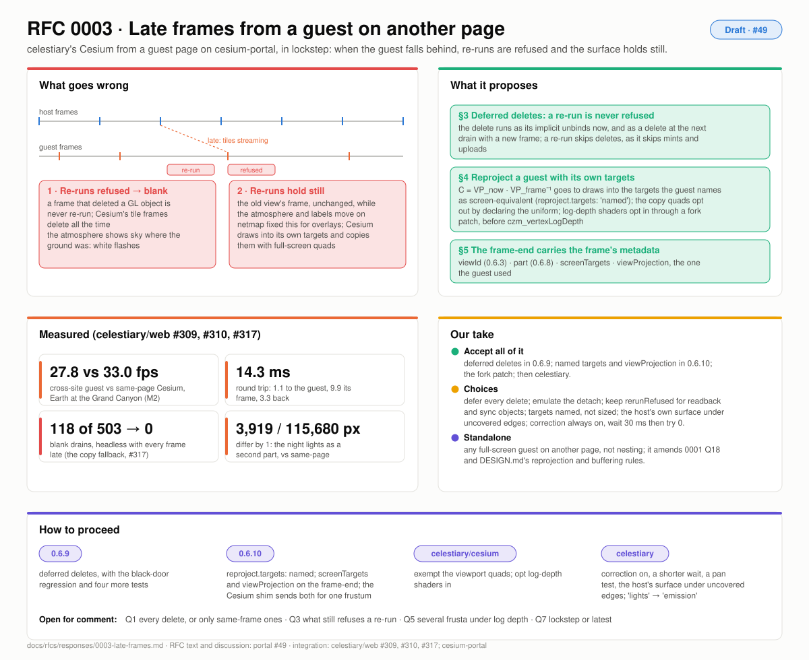

# Response to RFC 0003: late frames from a guest on another page

| | |
|---|---|
| **RFC** | [#49](https://github.com/pablo-mayrgundter/portal/issues/49) |
| **Integration** | celestiary drawing Earth's, the Moon's and Mars's Cesium from guest pages on `pablo-mayrgundter.github.io/cesium-portal`, in lockstep: post the view, render the host's scene, wait up to 100 ms for the guest's frame, else re-run the last one |
| **Built** | celestiary/web #309, #310, #317 (`?cesium=iframe`, the copy fallback), portal-netgl 0.6.3–0.6.8 (reprojection, parts), 0.6.9 (deferred deletes, #54), 0.6.10 (named screen targets, the guest's own view and projection on the frame-end). The Cesium fork's patch and celestiary's steps are next. |
| **Tracks** | T1 (late frames), with a field for T3 (the view) |
| **Picture** | [rfc-0003.svg](./img/rfc-0003.svg) |

## What it asks

A guest that keeps up is invisible. One that doesn't, chiefly while
tiles stream in, fails two ways on the maintainer's M2: **re-runs are
refused** (the receiver never re-runs a frame that deleted an object, and
Cesium's tile-loading frames delete objects all the time), so the frame
goes blank and the atmosphere shows sky where the ground was; and **a
re-run holds still** while the host's atmosphere and labels move on.
netmap's reprojection fixed the second for an overlay guest, but not for
a guest that draws into its own targets and copies to the screen with
full-screen quads. The RFC asks for:

1. **deferred deletes**, so every frame can re-run: a delete runs as its implicit unbinds at its position and as a delete at the next drain with a new frame (§3);
2. **reprojection for a guest with its own targets**: the guest names its screen-equivalent framebuffers, the quads are exempted by the opt-in, log-depth shaders opt in through a fork patch (§4);
3. **the guest's own view-projection on the frame-end**, since Cesium builds its own frustum from the view (§4.3, §5);
4. a choice for **uncovered edges** after a pan (§4.5), and correction always on with a shorter wait (§4.6).

## What's built, and what it taught

| | measured |
|---|---|
| cross-site guest vs Cesium on the same page, Earth at the Grand Canyon (M2) | 27.8 fps vs 33.0 |
| the round trip | 14.3 ms: 1.1 to the guest, 9.9 the guest's frame, 3.3 back |
| drains that drew nothing, headless with every frame late | 118 of 503 before #317; 0 after, 121 of 536 drawing the kept copy |
| parts across the wire, the night lights at a night view | 3,919 of 115,680 pixels differ from the same-page Cesium, by 1 |

Two findings reach beyond this guest. **A hidden cross-origin iframe
and `requestAnimationFrame`:** three's `compileAsync` polls program
status on animation frames only, and the city inside the guest page's
Cesium stayed "building" for minutes on the M2 until the extension was
hidden from it. 0001's Q28 (render on view messages) has to cover a
guest's libraries too. **Two commits, two dialects:** a host preview
loaded main's guest page, which knew nothing of New York or parts, and
features were dropped silently; a guest page now reports the protocol it
speaks (T6).

## Our take

| Section | Proposal | Take |
|---|---|---|
| §3 | defer every `delete*` to the next drain with a new frame; emit the implicit unbinds at the delete's position; a re-run skips deletes as it skips mints and uploads | **Accept; 0.6.9.** Defer every delete (Q1): simpler, and bounded by one frame's deleted objects. Emulate the detach from the bound framebuffer per attachment (Q2): cheap, and it doesn't depend on reading Cesium's sources. `rerunRefused` stays for a frame with a `readPixels` or a sync object, and the copy fallback with it (Q3). |
| §4.2 | `reproject.targets: 'named'`; `screenTargets` on the frame-end; quads exempted by declaring the uniform without using it | **Accept; 0.6.10.** Named targets, not a size test: pick, OIT and FXAA buffers are viewport-sized too. The shim reads `scene._view` now and the fork gains a public accessor later (Q4). |
| §4.3 | `viewProjection` on the frame-end, for a one-frustum frame; no correction with several frusta | **Accept.** It is T3's view, reported back by the guest (built in 0.6.10 as the pair `viewMatrix`, `projectionMatrix`, which `reprojection()` takes without inverting the product). Measure how often log depth uses more than one frustum before building per-frustum corrections (Q5); sub-frames are the shape if it's often. |
| §4.4 | the fork's shader builder opts every log-depth vertex shader in, applying the correction before `czm_vertexLogDepth` | **Accept.** Portal changes nothing; the opt-in is 0.6.4's. |
| §4.5 | uncovered edges: the host's own surface, or overscan | **The host's own surface first** (Q6): host-side only, no fill cost on frames that are already slow. Overscan if the strip is still visible. |
| §4.6 | correction always on; `cesiumWait` 30 ms | **Accept.** Correction on, since for a frame that is on time it is the identity. Start at 30 ms, then measure 0 (compose the latest, as netmap does) against it (Q7). |
| §5 | `part` takes 0002 §6.3's names; `screenTargets` and `viewProjection` optional | **Accept.** celestiary's `'lights'` becomes `'emission'`. |
| §8 | 0.6.9, 0.6.10, the fork patch, then celestiary | **Accept the order.** Each ships on its own once green; the celestiary steps wait for the maintainer. |
| Q8 | whose RFC | **It stands alone.** It is about any full-screen guest on another page, not nesting; it amends 0001 Q18 and DESIGN.md's reprojection and buffering rules. |

## How to proceed

1. **0.6.9 (T1):** deferred deletes, with §3.5's tests: the black-door regression, a delete of the bound framebuffer followed by a draw, a delete of an attachment of the bound framebuffer, a re-run after a deleting frame drawing the same pixels, queued deletes running before the next frame's creates.
2. **0.6.10 (T1):** `reproject.targets: 'named'`, `screenTargets` and `viewProjection` on `netgl:frame-end`, the Cesium shim sending both for a one-frustum frame. Test: a Cesium-like guest (a scene target, a full-screen copy) drawn for one view and composed at another matches its own frame for the second.
3. **celestiary/cesium:** the exempted quads and the log-depth opt-in.
4. **celestiary:** correction on, a shorter wait, a pan test in `cesium-guest-check`, the host's own surface under uncovered edges; `'lights'` renamed `'emission'`.
5. **DESIGN.md:** the buffering rules become *deferred deletes*; *Host reprojection* gains the named-targets mode and the guest's projection; *Limits* drops "leave `reproject` off" for full-screen composites.

## What we're asking

From anyone who has composited a renderer's frames late: whether
deferring every delete is safe in cases we haven't met (a guest that
reuses an id in the same frame, a guest that reads back), and whether
lockstep with a short wait or always-latest is the better default for a
full-screen guest.
