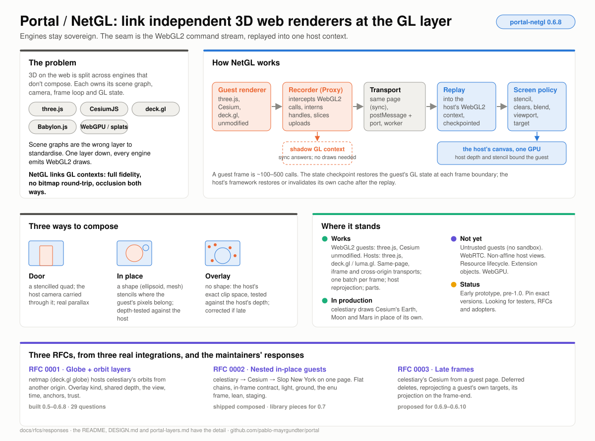

# Responses to the RFCs: what they ask, and the tracks of work

Three RFCs now exist, one per real integration, and each was written
from a different seat: a cross-origin overlay over a deck.gl globe, a
three-engine chain on one page, and a full-screen Cesium on a guest
page. This directory reads them together. For each RFC there is a
**1-pager** (our understanding of what it asks, our take on each
proposal, proposed answers to its open questions, and how to proceed)
and an **infographic**. This page is the synthesis: the requirements the
three share, the tracks of work that answer them, and the portal-netgl
versions each track claims.

It is also the model we'd like public comment to follow: an RFC states a
need from a real integration; a response says what the maintainers would
build and why; the open questions are where the argument is.

| | Read | Picture |
|---|---|---|
| What portal and NetGL are | the [README](../../../README.md) | [overview](./img/portal-netgl.svg) |
| RFC 0001, globe + orbit layers | [1-pager](./0001-globe-orbit-layers.md) | [infographic](./img/rfc-0001.svg) |
| RFC 0002, nested in-place guests | [1-pager](./0002-nested-in-place-guests.md) | [infographic](./img/rfc-0002.svg) |
| RFC 0003, late frames from a guest on another page | [1-pager](./0003-late-frames.md) | [infographic](./img/rfc-0003.svg) |

## The three scenarios

| | RFC 0001 | RFC 0002 | RFC 0003 |
|---|---|---|---|
| Integration | netmap (deck.gl globe) hosting celestiary's orbits | celestiary (three.js) hosting Cesium hosting Slop New York (three.js) | celestiary hosting Cesium from a guest page on another site |
| Binding | cross-origin iframe, asynchronous, wire 2 | same page, synchronous, two links deep | cross-site iframe, lockstep (wait up to 100 ms, then re-run the last frame) |
| Composition | overlay: no stencil, the host's clip space, tests the host's depth | overlay inside the host's pass (`phase: 'opaque'`), writes the host's log depth, one draw per frustum | in place: a stencilled ellipsoid, depth saved and restored |
| Host adapter | luma.gl: restore (`pushState` / `popState`) | Cesium (fork): invalidate (`Context.resetState()`) | three.js: invalidate (`resetState()`) |
| What it stresses | the control plane, time, anchors, trust, the wire's cost | nesting, GPU and memory cost, light and colour, terrain, frames on the Earth | frames that arrive late, re-runs, reprojection of a guest with its own targets |
| Where it lives | [`0001-globe-orbit-layers.md`](../0001-globe-orbit-layers.md), discussion in [#39](https://github.com/pablo-mayrgundter/portal/issues/39) | [#38](https://github.com/pablo-mayrgundter/portal/issues/38) | [#49](https://github.com/pablo-mayrgundter/portal/issues/49) |
| Built | portal-netgl 0.5.0 to 0.6.8; celestiary/web #296, #304; netmap #7, #8 | celestiary/web #287, slop-newyork #1, the Cesium fork's external renderers; the library pieces not yet | celestiary/web #309, #310, #317; the two portal steps not yet |
| Open questions | 22 in the doc, 7 more findings in #39 | 18 | 8 |

## What they have in common

Read side by side, the three ask for the same ten things. Each RFC
names some of them; none names all.

| | Requirement | 0001 | 0002 | 0003 |
|---|---|---|---|---|
| R1 | **One precise view.** Frames by id, matrices in doubles, metres, the clip range supplied, the depth encoding per view, a sub-frame and host-frame index, a phase, a part, a light, an opacity | §6 | §5.3–5.4 | §4.3 |
| R2 | **Frame metadata on the frame-end.** The view it was drawn for, which part it is, which of the guest's targets stand for the screen, the projection it used | §10.4, Q18 | §5.5 | §5 |
| R3 | **A screen policy that says what a guest may touch.** No clears, no stencil writes, an occlude blend, discard while warming, a scissor for a guest the host doesn't trust | §5.1, §12 | §6.4, §9.4 | — |
| R4 | **Late frames are normal.** A re-run is never refused, a late frame is corrected to the current view, the host chooses between lockstep and latest | §10.4, Q29 | — | §3–4 |
| R5 | **Cost under control.** The shadow context draws nothing it needn't, set-up is staged over frames, uploads are sliced and batched, each link has its own handle table and disposes through it | Q29 | §4, §9, §10.3 | §7.1 |
| R6 | **Nesting flattened.** A leaf replays into the root; the middle exposes its link, a resync and a handle lookup | §9 | §4 | — |
| R7 | **Negotiation.** `hello` / `hello-ack` with a version, capabilities, extensions, a trust tier, a layer path; lifecycle states around it | §10.6–10.7 | §10.1–10.2 | §7.4 |
| R8 | **Domain extensions.** Time, anchors, light, ground, an Earth model, an `enu` frame, each negotiated by name | §7, §8 | §6, §7, §8 | — |
| R9 | **Trust by tier.** Bundled, same-page, trusted-origin, untrusted-gl, isolated; a nonce and a port; allow-lists that are build-time constants; budgets | §10.2, §10.5 | §10.6 | — |
| R10 | **Packaging and release.** Entries per framework, a version claimed per track, a guest page that says what it speaks, RFCs as issues for now | Q23–Q24 | §12 | §7.4 |

## What's settled already

These were open in an RFC and have since been answered by an
implementation, a comment on #38 or #39, or by a later RFC. The
responses treat them as decided and say where.

- **The overlay kind, `clear: 'none'`, sub-frames and parts** (0001 §4, §5.1, §9.7; portal #34, #36, #48).
- **One batch per frame over a port, sliced uploads** (0001 Q29; portal-netgl 0.6.0): 187 messages and 505 KB a frame became 1 and 48 KB; the host's decode went from 210 ms a frame to under a millisecond.
- **Host reprojection for overlay guests** (0001 Q29; 0.6.3–0.6.7).
- **`viewId` and `part` on `netgl:frame-end`** (0001 Q18; 0.6.3, 0.6.8). The frame-end is where a frame's metadata goes; RFC 0003 adds two more fields there.
- **Depth writes default per host** (0001 Q3; the #39 comment of 2026-10-24): deck keeps `false`, Cesium requires `true`.
- **Same-page chains flatten through the middle's link; the root creates cross-origin children; composed is the fallback** (0001 Q11; 0002 §4.3).
- **Phases exist, for synchronous bindings; async bindings get one insertion point per frame** (0001 Q13; 0002 §5.7).
- **Guests render on view messages, never on their own `requestAnimationFrame`** (0001 Q28; 0003 §7.3 extends it to the guest's libraries).
- **The host queues control posts until the guest's first hello** (0001 Q25) and **a guest may ask for a fresh view with `layer:invalidate`** (Q26): both built in #36, both to be made normative.

## Tracks

Six tracks answer the ten requirements. Each is anchored in one
integration's exit test, and each claims its portal-netgl versions below,
which is the answer to 0001's Q23 (two sessions once bumped the same
version): **a track claims its next version here before bumping it.**

| Track | What it builds | From | Exit test |
|---|---|---|---|
| **T1 Late frames** | Deferred deletes, so a re-run is never refused. `reproject.targets: 'named'`, with the guest naming its screen-equivalent targets and sending the view-projection it used on the frame-end. Log-depth shaders opt in. | 0003 §3–5; 0001 Q29 | celestiary's Cesium on a guest page: no blank drains headless with every frame late; a pan composed at the current view matches the page's own frame |
| **T2 Nesting and cost** | `makeNetGLNestedLink` (the leaf replays into the root), `resync()` and `resolve()` on the middle, `shadow: 'lean'`, a staged set-up that stops chunking at the first frame, `stencil: 'no-write'`, `blend: 'occlude'`, dispose through the link, the Cesium shim deferring its checkpoint | 0002 §4, §5.5, §9, §10.3 | the city compiles twice, not three times; 0 city draws in Cesium's shadow; no one-frame flicker on a real GPU; celestiary's `netglLean.js` deleted |
| **T3 The view and depth contract** | `LayerView` v2 as one type every host fills: any registered frame id, `clipRange`, `depth` per view, `subFrame.hostFrame`, `phase`, `light`, `opacity`; `SharedDepth` with the encoding's kind only; `LayerExtent.box` | 0001 §5–6; 0002 §5.3–5.6; 0003 §4.3 | deck as host, Cesium as host and Cesium as guest all fill the same type, and the tests that check a guest's projection against each host's own hold |
| **T4 Light, ground and frames** | `portal.light/1` (units, the host's sun and sky, `lit` / `emission` / `occlude` passes), `portal.ground/1` (the guest names sample points, the host answers heights and a budget), the `enu` frame descriptor; the guest options in slop-newyork; a Cesium-as-host adapter generic over `enu` guests | 0002 §6–8 | celestiary's `inCelestiaryFrame` and `inCelestiaryUnits` stopgaps deleted; the city's credits shown; the city's median luma within 10% of the ground's |
| **T5 Control plane and trust** | `layer:hello` / `hello-ack` with a version, capabilities, extensions, a layer path and a trust tier; the nonce and the port; `trusted-origin`'s cheap checks (a method allow-list, no reads from the host's framebuffers, budgets); `portal.time/1` and `portal.anchors/1` as specified, with near-N; lifecycle states; the layer manifest. This is where `portal-layers` 0.1 is cut from portal-netgl. | 0001 §7, §8, §10; 0002 §10, §12 | celestiary's layer page and netmap interoperate on one envelope with no app-side `originTransport`; a refused guest sees the reason; an allow-listed guest can't read the host's framebuffer |
| **T6 Packaging and release** | Entries per framework (`/core`, `/three`, `/luma`, `/cesium`), each framework an optional peer; this table as the version-claim register; a guest page reports the protocol it speaks; the RFC index points at the issues | 0001 Q23–Q24; 0002 §12; 0003 §7.4 | a deck host bundles portal-netgl without three.js; no two tracks publish the same version |

## Versions

portal-netgl is at 0.6.8. RFC 0003 reserves 0.7 for the New York work,
and the plan keeps that.

| Version | Track | Contents | Answers |
|---|---|---|---|
| **0.6.9** | T1 | deferred deletes; `canRerun` true after any frame; `rerunRefused` kept for readback and sync objects | 0003 §3, Q1–Q3 |
| **0.6.10** | T1 | `reproject.targets: 'named'`; `screenTargets` and `viewProjection` on the frame-end; the Cesium shim sends both for a one-frustum frame | 0003 §4–5, Q4–Q5 |
| **0.7.0** | T2, T3 | the nested link, `resync()`, `resolve()`, `shadow: 'lean'`, the staged set-up, `stencil: 'no-write'`, `blend: 'occlude'`, dispose through the link; `LayerView` v2 and `SharedDepth` with the kind only | 0002 §4, §5, §9; 0001 Q3 |
| **0.7.x** | T4 | the `enu` frame helper; `portal.light/1` and `portal.ground/1` types and the Cesium-as-host adapter; the guest options land in slop-newyork beside it | 0002 §6–8 |
| **0.8.0** | T5, T6 | `hello` / `hello-ack`, the nonce and the port, the `trusted-origin` checks, `portal.time/1`, `portal.anchors/1`, lifecycle states, the manifest; `portal-layers` 0.1 published, `portal-netgl/core` stays the wire | 0001 §7, §8, §10; 0002 §10, §12 |
| later | | `isolated` routing for untrusted code; a `shader` projection kind for Web Mercator hosts; resource lifecycle (trimming handle tables); extension objects; a WebGPU sibling of the command stream | 0001 Q7, Q16; DESIGN.md open problems |

Outside portal, in step: celestiary/cesium (the fork) carries the
log-depth opt-in and the exempted quads (T1) and the external-renderer
hook (T2, T4); slop-newyork carries the guest's light, pass and
`stored-lit` options (T4); celestiary deletes its stopgaps as each track
lands; cesium-portal is proposed as the home of the Earth layers
(0002 §12, Q14), since it already hosts the Cesium guest pages.

## Decisions we're proposing

Where an open question cuts across RFCs, the responses take one
position. These are the ones worth arguing about; the alternatives are in
the 1-pagers.

1. **Frame metadata rides on `netgl:frame-end`**, never on a separate control message. (0001 Q18; 0003 §5.)
2. **Depth writes are a per-host default**, granted in `hello-ack`. (0001 Q3; 0002 Q4.)
3. **An in-frame guest is an overlay at a phase**, not a fourth kind. (0002 Q1.)
4. **Flat through the middle's link on one page; the root creates cross-origin children; composed stays as the fallback.** (0001 Q11; 0002 Q3.)
5. **Every delete is deferred**, and a re-run is refused only for readback and sync objects. Correction stays on in lockstep, and the wait shrinks. (0003 Q1, Q3, Q7.)
6. **Trust: build `trusted-origin`'s cheap checks; route untrusted code to `isolated` bitmaps rather than build `untrusted-gl`.** A scissor from an overlay's extent is cheap and goes in the screen policy regardless. (0001 Q1, Q16, Q21.)
7. **The control plane moves to `portal-layers`;** portal-netgl keeps the wire, the receiver, the screen policy and the framework adapters, cut at 0.8. (0001 Q24; 0002 §12.)
8. **One allow-list format for `same-page` and `trusted-origin` guests**, carried by the manifest with the credits. (0002 §10.6, §12.3.)
9. **Anchors: near-N is required of a publisher with a large population; motion models stay out of the host.** (0001 Q15, Q22.)
10. **A 2D host gets anchors only in v1;** no `webMercator` projection in guests until a host-supplied shader prelude exists. (0001 Q7.)
11. **The `occlude` pass is the screen policy's by default** (`blend: 'occlude'`), with a guest-side pass as the opt-out where NaN or translucency bite. (0002 Q7.)
12. **The ground: the guest drapes within a host budget; the host picks the form; sea level is a scalar until a layer is wider than a city.** (0002 Q8–Q9.)

## What we're asking commenters

- **Host app authors** (a globe, a map, a CAD viewer): does R1's view
  carry what your renderer needs, and can your frame expose an insertion
  point and an invalidate-or-restore (0001 §11)? Which of the trust tiers
  would you actually run?
- **Guest engine authors** (Babylon, PlayCanvas, MapLibre, custom): can
  your engine take a context and a frame boundary (DESIGN.md's f → f′
  table), render on a view message rather than `requestAnimationFrame`,
  and declare that it never reads back?
- **Security readers:** is decision 6 right, and what would make
  `untrusted-gl` safe enough to build (0001 §10.5)?
- **Geospatial readers:** the `enu` descriptor, the Earth model and
  surface mapping, the anchor prefix registry (0001 §6.3, §8.2; 0002 §8).
- **Anyone who has composited late frames:** deferred deletes and named
  targets (0003 §3–4), and whether lockstep or latest is the right
  default.

Comment on the issue that holds the RFC, citing its section or question
number. A comment that changes a response is folded into the 1-pager in a
reviewed commit that cites it, as the RFCs do with their findings.
