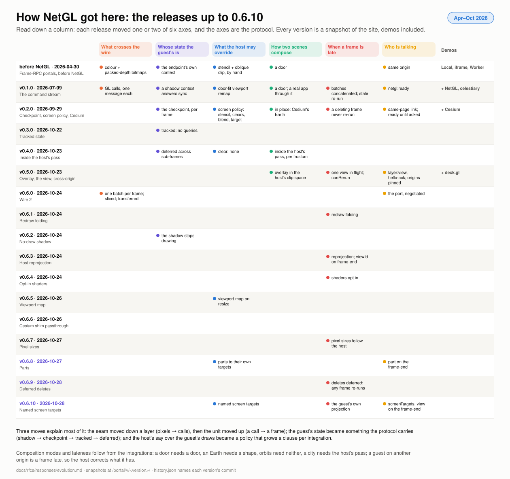

# How NetGL got here: the versions up to 0.6.8

Portal's protocol wasn't designed and then built. It was built against
three integrations, and each release moved one of a few axes. This page
reconstructs that history: each release of portal-netgl, what it added,
which demos existed, and a snapshot of the site as it was then, rebuilt
from the commit. The RFCs have no predecessors; they start at 0.5.0. The
point is the through line, which the table after the releases tries to
tease out.

**Snapshots.** Every version below is kept at
`https://pablo-mayrgundter.github.io/portal/v/<version>/`, and the
version pulldown in the header moves between them. Versions before 0.6.8
are reconstructions: the demos rebuilt from the last commit on `main` at
that version, with that commit's lockfile and submodule pointer, carrying
a banner that says so. They have the demos of their day and no docs
site. What a snapshot freezes is what the commit pins: its npm
dependencies through the lockfile, and celestiary through the submodule
pointer (until recently celestiary was an installed package, pinned the
same way). What it doesn't freeze is a **dynamic network dependency**:
a guest page served from another origin, such as celestiary's layer
page in netmap or the Cesium guest pages celestiary loads from
cesium-portal. Those are meant to move, and a snapshot that talks to
one talks to what that origin serves today. That is the point of a
network dependency, and it is versioned by the protocol it speaks, not
by its source: the host and the guest agree in the handshake on the
wire (1 or 2) and the layer protocol version, and an old host snapshot
against today's guest is a compatibility test of exactly that. None of
this repo's own demos has such a dependency yet (the deck.gl demo's
cross-origin guest is its own build), so today every snapshot is
self-contained; the one run-time fetch is OpenStreetMap tiles when a
Cesium demo is asked for them (`?imagery=osm`).

## The releases

| Version | Date | Commit | What it added | Demos | Snapshot |
|---|---|---|---|---|---|
| before NetGL | 2026-04-26 to 04-30 | `6e3f1d5` | **Frame-RPC portals.** A door between two three.js worlds: the boundary is the door's projection on the portal plane, drawn with a halfspace stencil and an oblique near-plane clip. A `PortalEndpoint` across four transports (local, iframe, Worker, headless node), each shipping colour and packed-RGBA depth bitmaps per frame; traversal through the door; recursive portals; a server-side snapshot proxy for social previews. | Local, iframe, Worker | [`v/0.0.0-frame-rpc/`](https://pablo-mayrgundter.github.io/portal/v/0.0.0-frame-rpc/) |
| 0.1.0 | 2026-05-25 (published 05-28; last commit 07-09) | `9885d79` | **The command stream.** Three spikes in a week (a Proxy over `WebGLRenderer`'s context with pixel parity; recorder and replay through the portal transport; a `NetGLRenderer` façade), then the demo. A guest's WebGL2 calls are recorded by a Proxy, answered synchronously by a shadow context, interned by handle, posted one message each, and replayed in the host's context between a stencil paint and a frame-end marker. celestiary goes through a door unmodified but for a renderer hook: door-fit viewport remap, batches concatenated rather than overwritten, autoClear on for render targets and off for the screen, a full-viewport invisible iframe. Published to npm. | + NetGL, celestiary | [`v/0.1.0/`](https://pablo-mayrgundter.github.io/portal/v/0.1.0/) |
| 0.2.0 | 2026-09-26 (last commit 09-29) | `ed267d6` | **Guest core, checkpoint, screen policy, Cesium.** A framework-agnostic guest core, so a shim is context injection plus a frame boundary. The state checkpoint: the guest re-emits its GL state at each frame boundary, so a framework's cache survives a shared context. The screen policy: the host overrides stencil, clears and blending for draws to its screen, and redirects them into a target of its own. The same-page immediate link. Cesium as a guest through `getWebGLStub`, through a door and in place of a three.js Earth, with the moon occluding it and occluded by it. Door portals are windows, not pictures. The `f → f′` shim model, the `portal-layers` 0.1 design, the lessons from celestiary's Cesium layers, which run in production. | + Cesium | [`v/0.2.0/`](https://pablo-mayrgundter.github.io/portal/v/0.2.0/) |
| 0.3.0 | 2026-10-22 | `8bf5c59` | **Tracked state.** The checkpoint is built from state the recorder tracked, not queried: 79 synchronous GL queries per guest frame become 0. | | [`v/0.3.0/`](https://pablo-mayrgundter.github.io/portal/v/0.3.0/) |
| 0.4.0 | 2026-10-23 | `0e88bee` | **Inside the host's pass.** `clear: 'none'` keeps a guest's clears off the host's depth, and sub-frames let a host draw one guest several times in a frame with its own draws in between, the checkpoint deferred to the guest's next call. Built for Cesium drawing Slop New York per frustum, on its terrain. | | [`v/0.4.0/`](https://pablo-mayrgundter.github.io/portal/v/0.4.0/) |
| 0.5.0 | 2026-10-23 | `0b13021` | **Overlay, the view, cross-origin.** The deck.gl / luma.gl host adapter: a host that restores its state around the replay, where three invalidates. The overlay kind: no stencil, the host's exact clip space, tested against the host's depth. `layer:view` and the first control messages (`hello-ack`, `invalidate`, anchors on the deck adapter); control posts held until the guest is live. postMessage transports pinned by origin on both ends. A three.js overlay guest. RFC 0001 starts the series. | + deck.gl | [`v/0.5.0/`](https://pablo-mayrgundter.github.io/portal/v/0.5.0/) |
| 0.6.0 | 2026-10-24 | `18ea38d` | **Wire 2.** One batch per guest frame over a MessagePort, negotiated in the handshake so 0.5 peers still work; uploads sliced to the bytes a call reads; recorder-owned buffers transferred. A cross-site frame went from 187 messages and 505 KB to 1 and 48 KB, the host's decode from 210 ms to 0.1 ms. | | [`v/0.6.0/`](https://pablo-mayrgundter.github.io/portal/v/0.6.0/) |
| 0.6.1 | 2026-10-24 | `8543e93` | A redraw request restarts the fold window, so a frame that lands after a host draw still gets its own. | | [`v/0.6.1/`](https://pablo-mayrgundter.github.io/portal/v/0.6.1/) |
| 0.6.2 | 2026-10-24 | `976ae98` | `shadowDraws: false`: the shadow context skips its draws for a guest that never reads back. | | [`v/0.6.2/`](https://pablo-mayrgundter.github.io/portal/v/0.6.2/) |
| 0.6.3 | 2026-10-24 | `8b8551a` | **Host reprojection.** A late overlay frame is corrected to the host's current view: the replay rewrites the guest's vertex shaders once and multiplies `gl_Position` by `VP_now · VP_frame⁻¹`. `viewId` on the frame-end says which view a frame was drawn for. | | [`v/0.6.3/`](https://pablo-mayrgundter.github.io/portal/v/0.6.3/) |
| 0.6.4 | 2026-10-24 | `e174de2` | A vertex shader that declares `netgl_reproject` applies the correction itself, so wide lines keep their width. | | [`v/0.6.4/`](https://pablo-mayrgundter.github.io/portal/v/0.6.4/) |
| 0.6.5 | 2026-10-26 | `b7a1225` | A frame drawn for one buffer size is mapped when the host's buffer changed size. | | [`v/0.6.5/`](https://pablo-mayrgundter.github.io/portal/v/0.6.5/) |
| 0.6.6 | 2026-10-26 | `b84275f` | The Cesium shim passes `shadowDraws` through. | | [`v/0.6.6/`](https://pablo-mayrgundter.github.io/portal/v/0.6.6/) |
| 0.6.7 | 2026-10-27 | `e4f63d0` | A lagging frame's point sizes and line widths follow the host's pixel ratio. | | [`v/0.6.7/`](https://pablo-mayrgundter.github.io/portal/v/0.6.7/) |
| 0.6.10 | 2026-10-28 | | **Named screen targets.** A guest that draws into targets of its own names them on its frame-end, with the view and projection it drew with, and a host corrects the draws into them: reprojection for Cesium's full-screen composite. RFC 0003's second step. | | [`v/0.6.10/`](https://pablo-mayrgundter.github.io/portal/v/0.6.10/) |
| 0.6.9 | 2026-10-28 | `d7c2706` | **Deferred deletes.** Any frame can be re-run: deletes wait for the next new frame, their implicit unbinds happen in place. RFC 0003's first step. | | [`v/0.6.9/`](https://pablo-mayrgundter.github.io/portal/v/0.6.9/) |
| 0.6.8 | 2026-10-27 | `42e507c` | **Parts.** Several draws for one view, each to its own target: `part` on the frame-end, `beforeFrame` on the receiver. The RFC responses and this site. | + docs | [`v/0.6.8/`](https://pablo-mayrgundter.github.io/portal/v/0.6.8/) |

## The through line

Read down the columns rather than across the rows: each release moved
one or two of six axes, and the axes are the protocol.

| Axis | Before NetGL | 0.1 | 0.2 | 0.3 | 0.4 | 0.5 | 0.6.x |
|---|---|---|---|---|---|---|---|
| **What crosses the wire** | bitmaps: colour and packed depth per frame | GL calls, one message each | | | | | one batch per frame, sliced uploads, transferred buffers (0.6.0) |
| **Whose state the guest's is** | the endpoint's own context | a shadow context answers synchronously | the checkpoint re-emits it per frame | tracked, no queries | deferred across sub-frames | | the shadow stops drawing (0.6.2) |
| **What the host may override** | stencil and oblique clip, by hand per material | door-fit viewport remap | the screen policy: stencil, clears, blend, target | | `clear: 'none'` | | viewport map (0.6.5), parts to their own targets (0.6.8) |
| **How two scenes compose** | a door | a door, a real app through it | in place: Cesium's Earth under a stencilled shape | | inside the host's pass, per frustum | an overlay in the host's clip space | |
| **What happens when a frame is late** | | batches concatenated; a stale frame re-run | a deleting frame never re-run; ready re-sent until acked | | | one view in flight; `canRerun` | redraw folding (0.6.1); reprojection and `viewId` (0.6.3, 0.6.4, 0.6.7); deletes deferred, any frame re-run (0.6.9); named screen targets and the guest's own projection (0.6.10) |
| **Who is talking** | same origin | `netgl:ready` | same-page link | | | `layer:view`, `hello-ack`, `invalidate`; origins pinned both ways | the port negotiated (0.6.0); `part` on the frame-end (0.6.8) |

Three moves explain most of it:

1. **The seam moved down a layer, then the unit moved up.** Frame-RPC
   shipped pixels and lost depth precision in the packing; NetGL ships
   the calls that make the pixels. Per call was the right unit to prove
   fidelity and the wrong one to cross a process: wire 2 made the frame
   the unit, and the cost of the transport went away.
2. **The guest's state became something the protocol carries.** The
   shadow context answered the guest's questions; the checkpoint told the
   host what the guest believes; tracking made that free; sub-frames let
   a host interleave its own draws. Each step let the guest know less
   about the host.
3. **The host's say over the guest's draws became a policy, not a
   patch.** What began as the app toggling stencil on every material
   became the screen policy, then grew a clause per integration: no
   clears for a guest inside a pass, a viewport map for a resize, a
   target per part. The RFCs ask for the next clauses (no stencil writes,
   an occlude blend, a scissor for an untrusted guest).

The rest is composition modes and lateness, and both follow from the
integrations: a door needs a door, Cesium's Earth needs a shape, orbits
need neither, a city needs the host's pass; and a guest on another
origin is always a frame late, so the host learned to correct what it
has rather than wait.

## What the snapshots are, and aren't

- Each is built from its commit with that commit's own build action
  (`.github/workflows/snapshot.yml`), with the demos' base path set to
  the snapshot's directory. The commit before the build action existed
  gets its three frame-RPC demos built by hand.
- The banner at the bottom left of every snapshot page names the version
  and the commit, lists the other versions, and links to the docs at
  latest. It is injected at deploy time; it isn't in the commit.
- The `versions.json` the pulldowns read carries each version's date,
  label and demos from
  [`history.json`](https://github.com/pablo-mayrgundter/portal/blob/main/docs/rfcs/responses/history.json),
  which is where a new version's entry goes.
- A snapshot pins what its commit pins. A dynamic network dependency
  (a guest page on another origin) stays live, and compatibility between
  a snapshot and it is the negotiated protocol version's business, not
  the snapshot's. A demo here that comes to load such a guest will say
  so in `history.json`.
